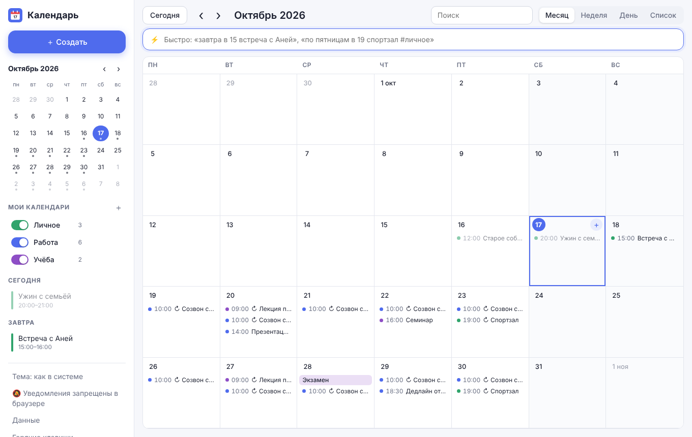

# Календарь на каждый день

Лёгкий и быстрый календарь в браузере. Работает офлайн, без регистрации и без сборки. Данные хранятся на устройстве и по желанию синхронизируются между телефоном и компьютером через бесплатное облако Supabase.



## Что умеет

- **Быстрое добавление фразой.** Пишете «завтра в 15 встреча с Аней» или «по пятницам в 19 спортзал» и жмёте Enter. Ещё до сохранения видно, как фраза будет понята. Shift+Enter открывает полную форму.
- **Календари-категории** «Личное», «Работа», «Учёба» со своими цветами. Каждую категорию можно включать и выключать переключателем, а кнопка «только» оставляет одну (повторное нажатие возвращает все). Рядом показано, сколько событий в категории на ближайшую неделю. Категории можно добавлять, переименовывать, перекрашивать и удалять.
- **Задачи со сроками.** Отдельный раздел «Задачи» с группами «Просрочено / Сегодня / Завтра / До конца недели / Позже / Без срока / Выполнено» и шкалой прогресса на сегодня. В календаре задачи видны отдельно от событий: с квадратиком, который можно отметить прямо в календаре, флажком ⚑ на линии дедлайна в виде «Неделя/День» и красным цветом, если срок прошёл.
- **Задачи к событию.** В окне события есть чек-лист «Что подготовить». Срок таких задач равен началу события и сдвигается вместе с ним, а на событии в календаре виден прогресс «✓2/5».
- **Пять видов:** месяц, неделя, день, список на 60 дней вперёд и задачи.
- **События на несколько дней** («с пятницы до воскресенья», «на выходных», «всю неделю», «с 20 по 25 октября») рисуются сплошной полосой через дни, как в Google Календаре. В форме для этого есть поле «По», а перетаскивание сдвигает такое событие целиком.
- **Повторы:** каждый день, по будням, каждую неделю, месяц или год, с датой окончания. Удалить можно одно вхождение, «это и следующие» или всю серию.
- **Напоминания** за 5 минут – 1 день, в виде системных уведомлений браузера.
- **Перетаскивание:** событие можно перенести на другой день или время, а длительность изменить, потянув за нижний край.
- **«Отменить»** после удаления, переноса и изменения.
- **Поиск** по названию и заметкам.
- **Тёмная тема** (автоматически или вручную).
- **Телефон:** адаптивная вёрстка, свайпы для листания, установка на главный экран как приложение (PWA).
- **Синхронизация устройств:** вход по email и паролю, общие события, задачи и календари на всех устройствах, мгновенные обновления, работа без сети с досылкой изменений. Настройка описана в [docs/SYNC_SETUP.md](docs/SYNC_SETUP.md).
- **Экспорт и импорт:** резервная копия в `.json`, обмен с Google, Apple и Outlook через `.ics`.

### Что понимает быстрое добавление

| Что | Примеры |
| --- | --- |
| День | сегодня, завтра, послезавтра, через 3 дня, через неделю, в пятницу, в следующий вторник |
| Дата | 25 декабря, 25.12, 25.12.2026 |
| Время | в 15, в 9:30, в 7 вечера, с 10 до 12, 14:00–15:30, весь день |
| Несколько дней | с пятницы до воскресенья, с пт по вс, со среды по пятницу, на выходных, на следующих выходных, всю неделю, всю следующую неделю, с 20 по 25 октября, с 28.10 по 3.11, на 3 дня, на неделю, до конца недели, до конца месяца |
| Повтор | каждый день, по будням, по понедельникам, каждую неделю, каждый месяц, каждый год |
| Календарь | #работа, #учёба, #личное (хватит начала: #раб) |
| Срок задачи | до пятницы, к понедельнику, до 25.10, до 18:00 |
| Важность | ! в конце, «важно», «срочно» |

Переключатель «⚡ Событие / ☑ Задача» слева в строке (или Tab в пустой строке) выбирает, что создавать. В разделе «Задачи» строка сразу создаёт задачи. Фраза, начинающаяся со слова «задача», всегда создаёт задачу, например «задача сдать отчёт до пятницы 18:00 #работа !».

Без метки событие попадает в первый включённый календарь. Например, если сейчас включена только «Работа», новое событие окажется в ней.

### Горячие клавиши

`Q` — быстрое добавление, `N` — новое событие, `T` — сегодня, `←`/`→` — листать,
`M`/`W`/`D`/`A` — месяц/неделя/день/список, `З` (`P`) — задачи, `1`…`9` — показать или скрыть календарь
(`Shift`+цифра — только он), `/` — поиск, `?` — подсказка.

## Запуск

Откройте `index.html` в браузере. Для офлайн-режима и установки на телефон нужен HTTP-сервер:

```bash
npm start            # то же, что python3 -m http.server 8080
# откройте http://localhost:8080
```

Опубликовать можно на любом статическом хостинге, например на GitHub Pages: Settings → Pages → Deploy from branch.

## Устройство

| Файл | Что внутри |
| --- | --- |
| `index.html` | разметка |
| `style.css` | стили, светлая и тёмная темы |
| `core.js` | логика без DOM: даты, повторы, разбор фраз, сроки задач, `.ics` |
| `tasks.js` | задачи: раздел «Задачи», задачи в календаре, чек-лист события |
| `app.js` | интерфейс календаря |
| `sync.js` | синхронизация через Supabase: движок слияния и окно входа |
| `config.js` | адрес проекта Supabase и публичный ключ (пусто — синхронизация выключена) |
| `supabase/schema.sql` | таблица и правила доступа для Supabase |
| `vendor/` | библиотека supabase-js 2.117.2 (лежит в проекте, чтобы работать офлайн) |
| `sw.js` | офлайн-кэш и клики по уведомлениям |

Тесты логики: `npm test` (нужен Node.js 18+).

> Без синхронизации данные хранятся только в `localStorage` этого браузера. Время от времени скачивайте резервную копию: «Данные» → «Скачать резервную копию».
